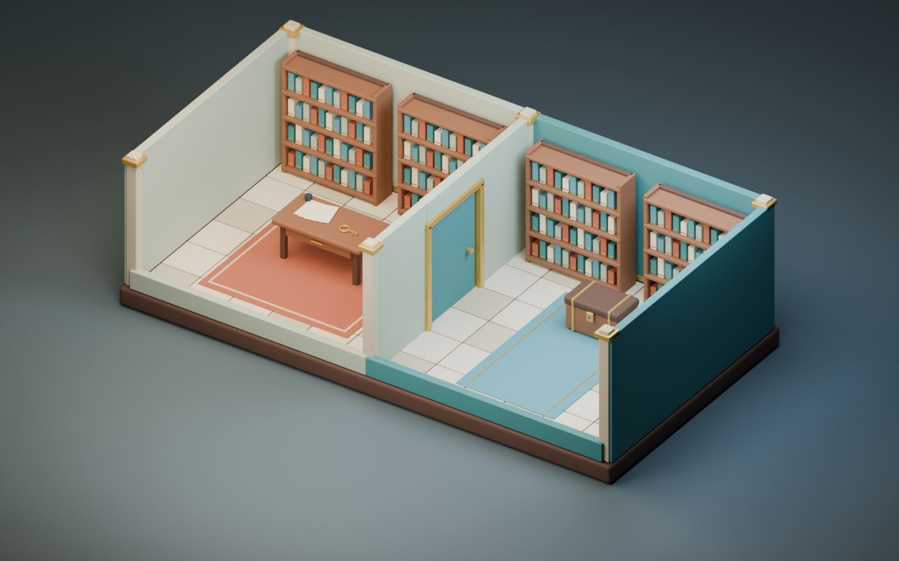
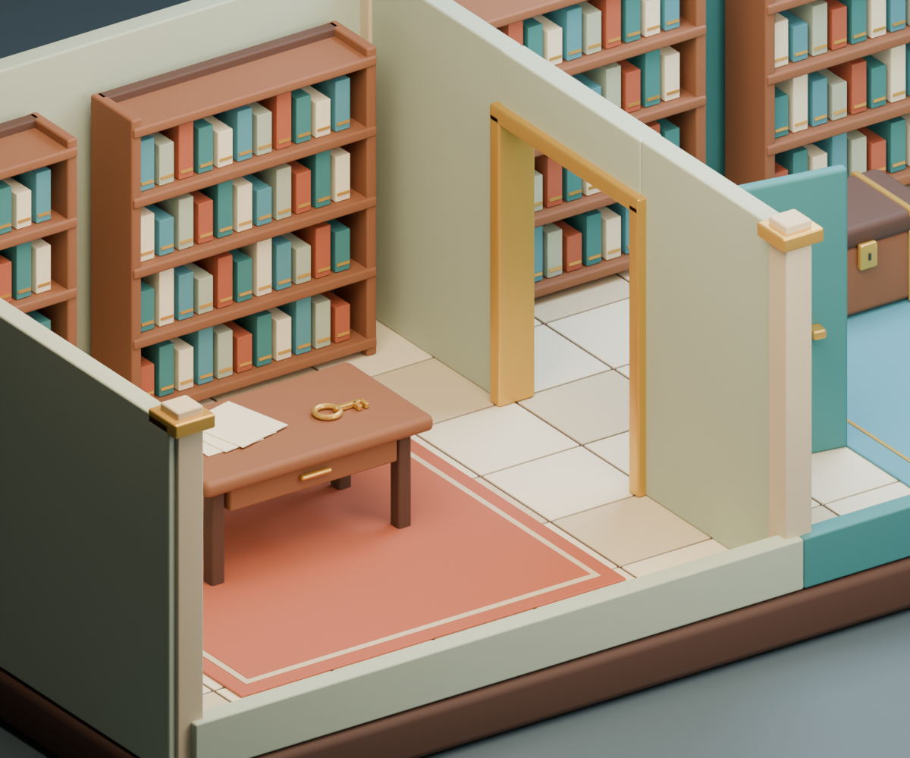

# Library of Origins — Blender world prototype

Two connected 6 × 6 metre rooms: a cedar drafting desk with a removable brass
key, a teal archive with a chest, and a separate hinged door. Simple geometry,
plain PBR materials, no textures, no paid/generated assets. The open roof and
low front walls provide a deliberate cutaway view. The doorway is 1.8 m wide
and 2.54 m high; the door opens 100 degrees into the archive over two seconds.

This completes the **Blender scene/export milestone** in TASKLIST. These assets
are a prototype, not a registered theater asset type or a playable adventure
mode. The existing checkers game and theater configuration are unchanged.
Walking, authoritative interactions, inventory, packaging support, persistence,
and the live 3D canvas still need the subsequent TASKLIST milestones.



## Files

| File | Purpose |
| --- | --- |
| `library.blend` | Editable source with materials, camera, lights, and door animation |
| `build.py` | Deterministic procedural scene construction, GLB export, and renders |
| `library.glb` | Complete initial scene, including independently removable entity roots |
| `environment.glb` | Static room shell, shelves, books, and rugs |
| `desk.glb`, `brass_key.glb`, `archive_chest.glb`, `archive_door.glb` | Reusable entity models at local origin |
| `world.json` | Revision, placements, colliders, spawns, targets, triggers, animation metadata |
| `preview.html` | Standalone Three.js orbit preview with door/key controls |
| `verify.mjs` | Asset checks and Chromium smoke verification |
| `preview.png`, `preview_door_open.png` | Blender renders of the closed scene and open doorway |
| `preview_browser.png`, `preview_mobile.png` | Actual Three.js/Chromium screenshots |

The full scene is approximately **2.05 MB**, below the 5 MB initial-download
target, with 39,252 triangles. `world.json.initial_download_bytes` records the
exact measured size on each build. Load **either** `library.glb` **or** the
environment plus reusable models, to avoid duplicating geometry. Preview code
and the Three.js dependency are additional bytes, separate from the scene.

## Rebuild

Run from the repository root with Blender 5.3 installed:

```powershell
uv run adventures/example_adventure/worlds/library_of_origins/build.py
```

The launcher finds Blender on PATH or in its standard Windows installation
directory. Set `BLENDER_PATH` or pass `--blender 'C:\path\to\blender.exe'`
to override it. Add `--skip-render` to regenerate assets without the PNGs.
`uv` runs the project launcher; Blender's bundled Python supplies `bpy` inside
the Blender process. No project dependency installation is needed for the build.
Rebuilding replaces the generated `.blend`, GLBs, manifest, and rendered PNGs;
make lasting edits in `build.py`, since rebuilding replaces manual Blender edits.
The saved source opens at the closed-door pose, with `door_open` on frames 1–49.
The export shifts the clip to time zero (0–2 seconds at 24 fps).

## Preview and verify

Serve the folder from the repository root:

```powershell
uv run python -m http.server 8026 --bind 127.0.0.1 --directory adventures/example_adventure/worlds/library_of_origins
```

Open <http://127.0.0.1:8026/preview.html>. Drag to orbit, scroll to zoom, and
right-drag to pan. Buttons preview the door clip and key visibility; they do
not implement game actions. Three.js **0.180.0** is pinned in the import map
and loaded from jsDelivr, so the preview needs internet access. GLBs and
Blender renders have no external dependencies.

With the repository's existing Node development dependencies installed:

```powershell
npx playwright install chromium
node adventures/example_adventure/worlds/library_of_origins/verify.mjs
uv run ruff check --no-force-exclude adventures/example_adventure/worlds/library_of_origins/build.py
```

Verification checks GLB headers, the download budget, stable entity IDs,
placements, local-origin reusable assets, metadata references, and independent
environment geometry. It then loads the export in Chromium/Three.js, checks
its dimensions and Y-axis door rotation, exercises door/key/reset controls,
checks mobile overflow, and captures browser previews. This is asset validation;
it does not measure performance on physical phones or implement collisions.

## Spatial contract

- Blender: metres, Z up, X east, Y north. Origin is floor level in the doorway.
- GLB/manifest: metres, **Y up**, X east, **−Z north**. Conversion:
  `(blender_x, blender_y, blender_z) → (x, z, −y)`. No extra root rotation is needed.
- Convert to a future integer millimetre game contract by multiplying positions
  and sizes by 1000 and rounding. This manifest is a prototype, not canvas API v2.
- Reusable assets have identity root transforms; apply their manifest positions
  once. The complete scene already includes these placements.
- Rotations use XYZW quaternions; `yaw_radians: 0` faces −Z. The origin of the
  door entity is its hinge; `door_hinge` is the animated child pivot.
- IDs, spawns, interaction targets, and trigger markers also appear in GLB node
  names and custom-property `extras`. Collider markers are empties, not visible meshes.
  See the [Blender glTF exporter documentation](https://docs.blender.org/manual/en/5.4/addons/scene_gltf2.html)
  for custom properties and animation export behavior.
- Collider boxes are axis-aligned. Environment collider centers are world-space;
  entity collider centers are local to their entity. Sizes are full extents.
  Interaction target positions and trigger volumes are world-space.
- `entry` starts in the drafting room; `archive_entry` is beyond the door.
  `discover_key` and `enter_archive` are trigger volumes with semantic intents.
- The host must enforce room bounds, validate reach/ownership, and attach intents
  to server transitions. Collecting the key removes only `brass_key`. Unlocking
  the door plays `door_open` once, clamps its final pose, and disables
  `collision_closed_door` atomically. Model import alone grants no behavior.
- Front-wall colliders match the low cutaway geometry. Enforce horizontal region
  bounds to keep players inside; the open roof is a presentation choice. Only the
  door's closed-state collider is supplied; a swept swinging-door simulation is
  outside this prototype. The chest is static and has no opening clip.


