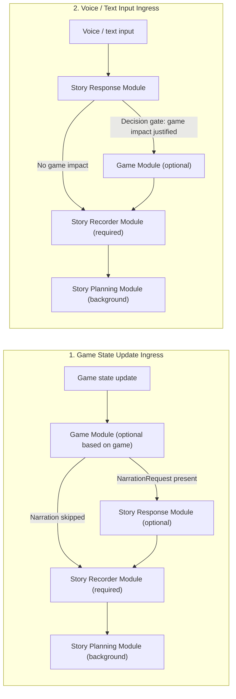

# ADR-002: Extract single-pass StoryGameModule from StoryRecorderModule

- Status: Accepted
- Date: 2026-11-10
- Scope: Adventure Mode story orchestration in `components/story`
- Supersedes in part: [ADR-001](adr-001-recorder-planner-responder.md) (game-control responsibilities in `StoryRecorderModule`)

## Context

In [ADR-001](adr-001-recorder-planner-responder.md), `StoryRecorderModule` was responsible for two distinct duties:

1. **Factual state recording**: reconciling completed turns against established sticky notes and lore, committing recorder-owned sticky notes, and applying canonical character/scene/player-character reference updates.
2. **Narratron game control**: evaluating committed player game actions, executing Narratron counter-actions through the validated game runtime, gating whether a player game move warrants immediate story narration (`NarrationRequest`), and translating spoken/text story outcomes into Narratron game actions.

Combining game control and factual recording inside `StoryRecorderModule` created several problems:

- **Bidirectional coupling between responder and recorder**: On game-entry turns, `StoryRecorderModule` ran before `StoryResponseModule` (as game controller), while on communicated-action turns `StoryRecorderModule` ran after `StoryResponseModule` (combining game actions with factual recording).
- **Mixed prompt and lore context**: `RECORDER.md` had to mix factual bookkeeping instructions with game-specific rules and action schemas, even on turns where no game action was needed.
- **Unnecessary multi-turn agent overhead for game decisions**: Game evaluation and counter-action selection can be resolved in a single structured pass (like `StoryResponseModule`) with a fast decision-model gate on story-response turns, rather than requiring a multi-turn ADK tool loop on every communicated turn.

## Decision

Extract all game logic from `StoryRecorderModule` into a dedicated, single-pass **`StoryGameModule`** (`components/story/story_game_module.py`) with its own pinned lore document **`lore/GAME.md`**.

### Role separation and authorized mutations

| Role | Module | Execution model | Pinned lore | Responsibility | Authorized mutations |
| --- | --- | --- | --- | --- | --- |
| **Responder** | `StoryResponseModule` | Single-pass (`DecisionProvider` + `TextResponseProvider`) | `lore/RESPONDER.md` | Resolve communicated player actions or narrate game-established briefs; emit narration, NPC dialogue, dice rolls, and proposed factual/reference updates | Structured `SceneReaction`; no direct sticky or game-state writes |
| **Game** | `StoryGameModule` | Single-pass (`DecisionProvider` + `TextResponseProvider`) | `lore/GAME.md` | Evaluate player game moves or completed story responses against game state and rules; execute permitted Narratron `game_actions`; decide whether a player game move warrants story narration (`NarrationRequest`) | Validated Narratron game actions via `GameState` and durable game-control decisions in `StoryRecordingJournal`; no sticky or reference writes |
| **Recorder** | `StoryRecorderModule` | Shared ADK session (`story_recorder`) | `lore/RECORDER.md` | Reconcile established turn outcomes (including any committed player and Narratron game receipts) into recorder-owned factual sticky notes and canonical reference updates | Recorder-owned sticky notes and canonical character/scene/player-character reference updates; no game-state mutations |
| **Planner** | `StoryPlanningModule` | Background ADK session (`story_deep_planner`) | `lore/PLANNER.md` | Asynchronous campaign pacing, hidden state, and contingent future possibilities | Planner-owned sticky notes; no game-state writes or peer triggers |

### Execution paths by user signal

`StoryEngine` orchestrates two linear foreground/background pipelines based on the ingress signal:

1. **Game state update path**:
   `Game state update -> (optional based on game) StoryGameModule -> (optional if game module decides) StoryResponseModule -> (required) StoryRecorderModule -> (possible) StoryPlanningModule`
   - When a player commits a game action, `StoryGameModule.control_game(event)` runs in a single pass, commits any justified Narratron counter-actions (`decision.game_actions`), and returns a `GameControlDecision` with an optional `NarrationRequest` (containing a concise narrative `brief` with no raw game state).
   - If `narration_request` is present, `StoryResponseModule` narrates the established outcome (`game_entry=True`).
   - `StoryRecorderModule.record(event)` then reconciles the factual sticky notes for the player game event and all committed Narratron receipts, commits the recorded revision, and publishes the completed events to `StoryRecordingJournal` history.
   - `BackgroundPlanning` (`StoryPlanningModule`) runs asynchronously in the background.

2. **Voice / text input path**:
   `Voice/text input -> StoryResponseModule -> (optional if story result should have game impact) StoryGameModule -> (required) StoryRecorderModule -> (possible) StoryPlanningModule`
   - `StoryResponseModule` resolves the communicated player action first and delivers the scene to the canvas output cycle without waiting on downstream recording.
   - In the background recording task, if the theater has an active game, `StoryGameModule.should_apply_story_response(event)` uses `DecisionProvider` (`PredicateQuestion(name="should_take_game_action")`) to analyze the current game state, the story response, and `GAME.md` rules.
   - Only when the decision model determines that a game action is justified (or when recovering a partially completed game stage) does `StoryGameModule.control_story_response(event)` invoke the single-pass game model to select and commit `game_actions` (with `narration_request=None`).
   - `StoryRecorderModule.record(event)` then reconciles factual sticky notes and canonical reference updates for the response and any Narratron game receipts, and commits the turn to history.
   - `BackgroundPlanning` (`StoryPlanningModule`) continues in the background.

### Single-pass `StoryGameModule` architecture

Like `StoryResponseModule`, `StoryGameModule` is single-pass and does not run an ADK multi-turn agent loop:

1. **Decision-model lore pre-selection**: Before invoking `TextResponseProvider.generate`, `StoryGameModule.collect_relevant_lore` queries `DecisionProvider` (`primary_lore_document` and `secondary_lore_document`) to pre-load up to two shared lore documents into the prompt and records those reads under `reader="game"` in `StoryRecordingJournal`.
2. **Decision-model gate on story responses**: On voice/text turns, `should_apply_story_response` evaluates a single `should_take_game_action` predicate over `Current Game State`, `Story Response`, and `Game Rules (GAME.md)`. Routine narrative turns skip the game model entirely.
3. **Structured single-pass generation**: `StoryGameModule._run_model` calls `TextResponseProvider.generate` with `response_schema=GameControlDecision`, which includes `game_actions: tuple[GameAction, ...]`, `narration_request: NarrationRequest | None`, and `reason: str`. Each proposed `GameAction` is validated and committed through `StoryGameModule._commit_game_action` against `GameState` with durable receipt recovery.

### Pinned `lore/GAME.md` isolation

- `LoreLibrary` maps `role="game"` to `GAME.md` (`ROLE_DOCUMENTS["game"] = "GAME.md"`).
- `GAME.md` is automatically pinned into `StoryGameModule`'s system instructions and excluded from shared lore listings and from `responder`, `recorder`, and `planner` lore reads.
- `StoryRecordingJournal` stores `StoryGameModule` decisions in `game_control_decisions` and `StoryRecorderModule` factual/reference decisions in `recorder_decisions` so both modules can persist decisions keyed by the same `event_id` without collision.
- `StoryTurn` tracks `game_completed` separately from `recorder_completed` so crash/retry recovery resumes at the exact unfinished boundary without re-executing committed game actions or repeating model calls.
