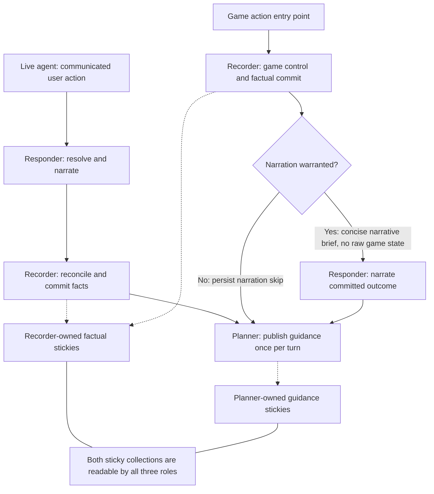

# ADR-001: Separate story recording, planning, and response

- Status: Proposed
- Date: 2026-10-20
- Scope: Adventure Mode story orchestration in `tools/story`

## Context

`StoryTool` currently composes a fast `StoryResponseModule` and a background
`StoryPlanningModule`. The responder resolves immediate player actions and emits
narration, NPC dialogue, dice results, and planning signals. The planner receives
player intentions and completed responses as separate events. It maintains all
durable sticky notes, performs permitted Narratron game actions, and can trigger
a response to a player game action.

This assigns two different kinds of work to the background planner:

- Recording established facts, including inventory, location, resources, and
  committed game developments.
- Developing conditional future events, opposition intentions, setups, and pacing.

Factual recording must finish before another action depends on its results.
Creative planning can take longer and run in the background. Combining
them allows the next response to encounter stale factual notes, spends planning
effort on routine bookkeeping, and complicates recovery from partial tool writes.

## Proposed decision

Introduce three roles with distinct write responsibilities. Keep `StoryTool` as
the composition root and orchestrator, with one shared notepad and shared lore
and reference services. All three roles use one ADK session, with a separate
model-visible event projection for each role.

| Role | Responsibility | Authorized mutations |
| --- | --- | --- |
| Recorder / game controller | Reconcile committed events, maintain factual state, and choose and execute permitted game responses | Recorder-owned stickies and game-state mutations through the validated game runtime |
| Responder | Resolve communicated user actions, narrate the immediate scene, speak for NPCs, and roll permitted dice; narrate recorder-established outcomes on game-entry turns | Structured response and proposed factual changes; no direct sticky or game-state writes |
| Planner | Develop contingent future events, faction intentions, setups, and pacing from committed facts | Planner-owned stickies; no game-state writes or peer triggers |

The recorder has two ingress-dependent modes: recording a completed response on
a communicated-action turn, or controlling and recording game developments on a
game-action turn. These are alternative uses of its one logical invocation per
turn, not a reason to invoke it again after the responder. Selecting a new NPC
game action is a new decision, not a fact inferred to have already happened. The
recorder is the sole role authorized to mutate game state; the game runtime
continues to validate, commit, and persist those mutations.

The agreed turn contract is: **one accepted ingress, one entry role, and at most
one invocation of each other role.** Recorder and planner stages are mandatory.
The responder runs once on communicated-action turns; on game-action turns the
recorder can omit narration when the action is minor or purely mechanical. The
entry role's completion causes the orchestrator to schedule the required remaining
stages once and persist any responder skip decision. Follow-up roles do not
recursively trigger peers. The planner only publishes sticky context for
subsequent invocations. A completed turn contains one logical recorder stage,
one planner stage, and either one responder stage or an explicit game-entry
narration skip.

## Sticky ownership in `planning.yaml`

Each sticky declares exactly one writer using `owner: recorder` or
`owner: planner`. Ownership applies to the whole topic; mixed topics should be
split into factual and planning topics.

```yaml
Inventory:
  owner: recorder
  description: "Items currently possessed."
  initial: "One brass key"

Location:
  owner: recorder
  description: "The player's established location."
  initial: "Outside the archive"

"Archive Investigation":
  owner: planner
  description: "Conditional opposition plans and future developments."
  initial: "The archivist investigates if evidence of entry is discovered."
```

The schema parser must preserve and validate ownership metadata. Role-scoped
schema and update tools must enforce it in application code. Instructions alone
are insufficient. Existing field schemas, rendering, and per-topic validation
remain applicable.

Ownership controls writing, not visibility. All three roles read both sticky
collections. Private planning material must not automatically become
player-visible. Recorder notes establish facts. Planner notes describe intentions
and conditional possibilities and must not be treated as proof that an event
occurred. Publishing a sticky update never schedules another role or opens a turn.

| Context / capability | Recorder | Responder | Planner |
| --- | --- | --- | --- |
| Read recorder-owned stickies | Yes | Yes | Yes |
| Read planner-owned stickies | Yes | Yes | Yes |
| Write recorder-owned stickies | Yes | No | No |
| Write planner-owned stickies | No | No | Yes |
| Read raw game state, receipts, game instructions, and action schemas | Yes | No | Yes |
| Mutate game state through the validated runtime | Yes | No | No |
| Trigger peers through model tools or sticky updates | No | No | No |

The responder's game-state exclusion is an application-enforced context boundary.
Do not supply raw game data through prompts, history, shared session state, tool
results, or summaries. It receives concise narrative facts from recorder-owned
stickies and an explicit recorder brief instead. Keep game analysis and complex
mechanical instructions in the recorder and planner so the responder stays fast.

## Event flow



Solid arrows represent orchestrator-controlled stage order, not model-exposed
peer-trigger tools. Dotted arrows publish state and have no scheduling effect.
The duplicated role boxes show alternative ingress paths, not additional
invocations in one turn. There is deliberately no game-entry edge from the
responder back to the recorder, and no outgoing scheduling edge from the planner.

### Communicated user actions: responder entry

1. The orchestrator assigns a stable action ID and ensures preceding causal
   events have been recorded before admitting the action communicated by the live
   agent. This ingress creates a turn whose entry role is the responder.
2. The responder reads a consistent snapshot of both sticky collections and its
   own permitted history, without raw game state. Player input remains an
   intention until resolved.
3. The responder returns narration, dialogue, actual dice results, proposed
   factual changes, and optional planning cues.
4. The entry completion schedules one recorder stage and one planner stage. The
   planner depends on the recorder's factual commit, so it cannot plan from a
   partially recorded response. Neither stage depends on a model planning request.
5. The recorder reconciles the result against established facts, lore, and game
   receipts, commits factual updates, and marks the event recorded. It does not
   trigger another responder invocation.
6. The planner receives the recorded outcome and committed state, then updates
   only its own stickies or explicitly completes with no changes. Its completion
   triggers neither the responder nor the recorder.

### Game actions: recorder entry

1. The game runtime validates and commits the player's action. Its action and
   resulting state receipt become input to the recorder. This ingress creates a
   turn whose entry role is the recorder.
2. The recorder updates factual projections and, when justified by game rules,
   selects permitted Narratron actions. Each submitted action uses the current
   game revision and produces a durable receipt. All factual projections of those
   receipts finish within this recorder stage before it completes.
3. The recorder decides whether the committed development warrants narration or
   NPC dialogue. Minor, routine, or purely mechanical actions may skip the
   responder. It returns an explicit narration decision with a reason and, when
   narration is requested, a concise brief containing established outcomes,
   relevant consequences, and narration cues. Raw game state, receipts, action
   schemas, revision bookkeeping, and mechanical instructions stay out of the
   responder's context.
4. Entry completion always schedules one planner stage and conditionally schedules
   one responder stage. The orchestrator persists the recorder's narration
   decision so retries cannot change a skip into a new invocation. If invoked,
   the responder narrates the committed outcome; it does not resolve the game
   again or establish additional state mutations requiring another recorder pass.
5. The planner receives the recorder-established facts, readable game state, and
   either the completed narrative handoff or the explicit narration skip. It runs
   once after the responder completes, or directly after the recorder when
   narration is skipped, and publishes guidance only through its own stickies.
6. The responder's completion does not trigger a second recorder stage. The
   planner's completion triggers neither role. An out-of-scope factual or
   mechanical mutation in the game-entry response is a contract violation to
   handle within that responder stage, not permission to start another role cycle.

### Turn lifecycle and trigger budget

`StoryTool` owns scheduling. Models return outputs and handoffs; they cannot call
one another directly. Record the ingress kind and entry role with the turn ID,
then use the bounded stage sequence for that ingress:

| Ingress | Entry stage | Follow-up stage | Final background stage |
| --- | --- | --- | --- |
| Communicated user action | Responder, once | Recorder, once | Planner, once |
| Committed player game action | Recorder, once | Responder, zero or once according to the recorder's narration decision | Planner, once |

Entry completion durably schedules the required follow-up stages once, with the
dependency order shown above. Only the game-entry responder stage can be skipped;
this never skips planning. Completing a follow-up stage only satisfies that
existing dependency; it cannot enqueue another peer invocation. Internal handoffs,
Narratron receipts, callbacks, planning cues, and sticky writes are not new ingress
events and cannot replenish the turn's trigger budget. Only a new accepted
external ingress opens a new turn.

One logical stage may contain model/tool continuations and may need failure
retries. Retries retain the same turn, role, stage identity, and committed effects;
they do not create another logical invocation or repeat successful downstream
stages. Mark a turn complete when every required stage has completed and any
optional responder skip is durably recorded, including explicit no-change
outcomes. Foreground readiness is separate: a subsequent action can proceed after
the recorder and any required responder have finished and all causal facts are
committed, while the planner continues in the background.

## Shared ADK session and role-specific event visibility

Use one ADK application, session service, and session identity for the adventure.
The identity includes `app_name`, `user_id`, and `session_id`; reusing only the
session ID across independently named applications does not establish a shared
session. Replace the current separate planner and responder session wiring with
an orchestrator that invokes the appropriate role within this shared context.

The session stores the complete persisted event history for debugging and
recovery. Each model request receives a projection of that history, selected by
role, event purpose, and causal position. Storing an event in the session does
not make it visible to every role.

| Context | Recorder | Responder | Planner |
| --- | --- | --- | --- |
| Own prior model outputs and tool exchanges | Yes | Yes | Yes |
| Another role's raw tool exchanges and private intermediate outputs | No | No | No |
| Player text intention | When needed for reconciliation | When resolving the action | When included in a recorded-turn handoff |
| Raw game state, committed receipts, game instructions, and action schemas | Yes | No | Yes, read only |
| Concise recorder narrative brief or narration skip | Own published decision | Brief only, when invoked on game-entry turns | Yes |
| Completed response and proposed factual changes | Explicit recording handoff on responder-entry turns; no second invocation on game-entry turns | Own response history | Recorded outcome on responder-entry turns; narrative handoff alongside recorder-established facts on game-entry turns |
| Recorder-owned factual stickies | Yes | Yes | Yes |
| Planner-owned guidance stickies | Yes | Yes | Yes |

Own-event visibility alone is insufficient: on responder-entry turns the recorder
needs the responder's result; on game-entry turns an invoked responder needs the
recorder's narrative brief. The planner needs the foreground stages' handoffs and
committed facts in either case. Cross-role communication uses
explicit handoff events and published state, without replaying a peer's entire
conversation. A handoff carries its source event IDs, intended recipients,
purpose, and source state revision. The orchestrator supplies this routing
metadata; a model cannot grant visibility to an event by writing instructions
inside its content.

Player inputs, game receipts, recording tasks, and planning requests have distinct
event kinds. Internal messages must never be interpreted as new player actions.
Preserve original author information and causal links when constructing views.
Tool results may use ADK's `user` content role, so filtering by content role or
author alone cannot identify player intent or a complete role history.

### ADK integration approach

The locally installed and locked ADK version is `google-adk==2.9.2`. Its content
builder supports branch-based history filtering, and `before_model_callback`
allows application code to modify the model request. Separate agent names in an
otherwise unfiltered session do not provide the required visibility policy.

Implement an application-owned context builder, applied through supported model
request hooks on every model call, including continuations after tools. Disable
automatic prior-history inclusion with `include_contents="none"`, then explicitly
assemble the role's permitted history, current input, and active tool exchanges.
That setting alone is not a privacy filter: ADK still supplies current-turn
content, which must also satisfy the role's visibility policy. Do not mutate or
remove events from the stored session to obtain a filtered view.

ADK branch filtering can supplement this policy when the workflow establishes
appropriate branches. Its ancestor/unbranched-event visibility does not by itself
express the handoff matrix above. Do not depend on the internal
`isolation_scope` field; the installed ADK explicitly reserves it for internal use.

Additional requirements:

- Preserve complete function-call/result pairs, IDs, and ordering in each model
  request. Do not splice tool results from another role into a live tool exchange.
- Give each role distinct output state keys and scoped mutation tools. Shared
  session state is not automatically isolated by event-history filtering; state
  interpolation, tools, and context builders must obey the same visibility rules.
- Compact or summarize each permitted view independently, retaining source event
  positions and audience. Disable session-wide automatic history compaction until
  it can preserve this policy; a mixed summary can expose private peer content.
- Coordinate session appends and shared-state commits through the orchestrator.
  A shared session does not itself make concurrent independent runner writes safe
  or make multi-event factual updates atomic. Background planning must retain the
  earlier snapshot and publication checks.
- Keep player-facing delivery separate from session persistence. Recorder and
  planner confirmations and internal handoffs remain internal even though the
  session contains them.

This consolidates storage and tracing while preserving distinct contexts. It does
not imply a shared model conversation, shared provider cache, or reduced token
cost without measurement.

## Consistency and failure handling

- Use stable action and event IDs, causal links, and durable recording progress.
  Distinguish a player intention, its resolved response, and individual committed
  game actions while preserving their relationship.
- Persist the ingress kind, entry role, and completion/scheduling state of each
  role stage. Duplicate callbacks and retries must not schedule a role twice.
  Persist the recorder's game-entry narration decision and reason; an explicit
  skip satisfies that optional stage without invoking the responder.
  Recovery must resume unfinished game control, narration, and planning as well
  as pending factual projection; a recorded event alone is not a completed turn.
- Record proposed factual changes as structured data alongside prose. The
  recorder must reconcile them rather than blindly accept them. Narrative claims
  cannot override the game runtime's validated state.
- Stage related factual note changes and publish them together with recording
  progress. A subsequent action must not read a partially recorded turn.
- Preserve committed game receipts across retries. Note recording and game
  actions are separate commit boundaries; retrying projection or narration must
  not execute an already committed game action again.
- Provide recovery for a game commit followed by a failed receipt write. Capture
  the action's receipt at its commit boundary, rather than reading a possibly
  newer game snapshot afterward. Acknowledging asynchronous narration submission
  is not evidence that its responder stage completed successfully.
- Capture the state revision with the actual response snapshot. A revision read
  earlier than the snapshot is insufficient to identify what the responder saw.
- If recording fails, retain the pending event and retry safely. Dependent player
  actions remain queued until recording finishes. Already delivered narration is
  not a license to skip recording or duplicate its effects.
- Planner work carries its source event position and relevant state dependencies.
  Recheck affected guidance before publication if newer facts invalidate it.
  Planner failure may delay guidance but must not block factual recording.
- Planner output cannot retcon established events. Once a planned development
  actually occurs through response resolution or a game action, the recorder
  records it as a fact.
- Restart restoration must preserve newer planner-owned state and monotonic
  revisions. Restoring the recorder's last checkpoint must not replace newer
  planner stickies with the older copies embedded in that checkpoint.

## Scheduling and efficiency

Every accepted turn schedules the recorder and planner exactly once in its
ingress-defined order. The responder runs once for communicated actions and at
most once for game actions, according to the recorder's narration decision.
The recorder processes its stage's factual events and game receipts within
that single invocation. Prefer ordinary code for direct projections of validated
game state. Keep any recorder model context and reasoning budget focused on
reconciliation and required game decisions.

The planner runs once per turn after the recorder and any required responder,
including game turns that skip narration, whether or not the responder supplied
a planning request. Existing planning requests become advisory
context, not scheduling authority. Do not run the planner separately for player
intent, each game receipt, and completed narration. Do not add autonomous idle
refinement runs to the turn. Retries resume the same planner stage. Explicit
initialization or maintenance work outside an external turn must have its own
identity and cannot trigger the responder or recorder.

Planner work can continue in the background after foreground readiness, but each
turn retains its own planner-stage identity and completion state. No-op planning
is valid. Background publication updates context passively; it never wakes the
other roles. The responder consumes narrative context and stickies only, leaving
raw game analysis to the recorder and planner.

This adds a recording completion boundary between dependent actions. It may
increase latency or total cost when an LLM recorder is required. It is a proposed
tradeoff, not a demonstrated performance improvement. Measure first narration
latency, readiness for the next action, cost per action, planning lag, and factual
continuity errors separately.

## Implementation direction

1. Add validated sticky ownership and role-scoped notepad tools. Migrate existing
   adventure schemas explicitly; do not silently guess ownership of legacy notes.
2. Extract factual recording, game actions, and game-triggered response handling
   into a recorder module. Retain creative planning in the planning module.
3. Extend structured response output with proposed factual changes and optional
   planning cues. Add a durable game-entry narration decision with a reason and
   an optional concise recorder-to-responder narrative brief. Enforce the
   responder's game-state exclusion across every context path; game-entry
   narration must stay within recorder-established outcomes.
4. Consolidate ADK wiring into one application/session and add the role-specific
   context builder, explicit handoffs, scoped output keys, and compatible history
   summarization. Preserve the full stored event history.
5. Add durable turn/event identity, role-stage scheduling and completion progress,
   staged note publication, and retry/restart handling before enabling the new
   scheduling behavior. Close receipt-write and snapshot-restoration recovery gaps.
6. Wire the two bounded ingress paths through `StoryTool`, including the optional
   game-entry responder stage and mandatory planner stage. Remove direct
   peer-trigger tools, planner game writes, and recursive response recording on
   game-entry turns. Route canonical character and scene mutations through
   explicit ownership contracts so they do not bypass factual recording. Preserve
   all three private role-guide filenames through uploads and imports.
7. Update the test harness to exercise production scheduling as well as a fully
   drained deterministic mode.

Validation should cover both ingress paths with exactly one logical invocation of
the recorder and planner, one responder invocation for communicated actions, and
zero or one responder invocations for game actions. Verify minor-action narration
skips, significant-action narration, durable skip decisions across retries and
restarts, unconditional per-turn planner scheduling, and no responder-to-recorder
bounce on game-entry turns. Also cover unauthorized sticky/game writes, rapid
dependent actions, partial failures and retries, game-action deduplication,
recovery after a game commit but before receipt persistence, unfinished-stage
recovery, preservation of newer planner notes on restart, stale guidance, and
prevention of trigger loops from callbacks or sticky updates. Capture
actual model requests to verify own-role history, authorized handoffs, exclusion
of peer internals and all raw game context from the responder, correct tool
pairing, summary isolation, and distinct output keys across interleaved runs and
restarts. Assert that planner publication only changes its stickies and invokes
no peer role.

## Alternatives considered

- **Keep the current split:** Fewer roles, but factual recording and creative
  planning continue to share scheduling and failure behavior.
- **Let the responder write factual notes directly:** Avoids a separate model
  pass, but adds reconciliation and game-control responsibilities to the fast
  responder. Useful as a performance baseline.
- **Wait for all three roles before admitting the next action:** Simple ordering,
  but puts background creative planning on every action's foreground critical path.
- **Recursively react to every peer completion:** Allows repeated reconciliation,
  but violates the once-per-role turn contract and can create unbounded loops.
- **Schedule planning only on responder request:** Can reduce planner runs, but
  does not satisfy mandatory per-turn planning, including turns without narration.
- **Narrate every game action:** Simple scheduling, but adds latency and narration
  noise for minor mechanical actions that the recorder can handle without a response.
- **Separate ADK sessions for each role:** Provides simpler history separation,
  but requires explicit synchronization and separate traces. Retain as a fallback
  if shared-session projections cannot reliably preserve visibility and recovery.

## Implementation progress

The first foundation is implemented in `components/notepad.py`:

- The schema parser preserves ownership and rejects explicit values other than
  `recorder` or `planner`. Legacy schemas remain readable without an inferred
  owner, but `Notepad.for_role(...)` requires every configured topic to have an
  explicit owner.
- Bound role tools expose `check_schema(topic)` and
  `update_sticky_note(topic, info)`. Authorization uses the current schema on
  every call. Scoped writes enforce field validation even when ordinary narration
  accepts unstructured notes, and hold the notepad lock through authorization
  and mutation.
- The example adventure's existing factual topics explicitly belong to the
  recorder. No creative planning topics were inferred from those facts.
- Ownership tests cover denied writes, legacy migration, field validation,
  schema replacement, reassignment, and revision preservation on rejected writes.

The three-role runtime is now wired into `StoryTool`:

- `story_session.py` (`StorySession`, `StorySessionService`, `StoryRoleRouter`,
  `build_role_request`, `project_role_contents`) binds `story_responder`,
  `story_recorder`, and `story_deep_planner` into one `narratron_story` ADK
  application and SQLite session with `include_contents="none"`, distinct output
  keys, serialized event appends, own-role complete tool-pair projections, and
  preservation of explicit `null` structured-output fields across ADK's
  `set_model_response` tool.
- `story_turn_journal.py` (`StoryTurn`, `StoryTurnJournal`) and
  `story_staged_notes.py` (`StagedStoryNotes`) persist bounded turn lifecycles
  (`communicated_action` and `game_action`), explicit game-entry narration
  decisions and reasons, staged role-scoped sticky writes, and atomic planner
  checkpoint commits (`commit_planning`), while `Notepad.restore_recorded_snapshot()`
  preserves newer planner-owned stickies across restarts.
- `components/canvas/game_state.py` persists `StoryGameCommit` records at the
  game commit boundary (`pending_story_actions`, `acknowledge_story_action`,
  `commit_story_action`, `story_action_commits`) and blocks new player game moves
  on unfinished foreground turns (`before_player_action`).
- `StoryTool` schedules the two bounded ingress paths without model-exposed
  peer-trigger tools, excludes raw game state and dice rolling from game-entry
  responder turns, routes canonical player/character/scene mutations through
  recorder-owned `CanonicalReferenceUpdate` records, and preserves `RECORDER.md`
  through `services/theater_builder.py`.
- `story_session_test.py`, `story_orchestration_test.py`, `adventure_runner_test.py`,
  and UI/testlab suites validate both ingress paths, role isolation on captured
  ADK `LlmRequest` payloads, narration skip persistence, receipt/stage recovery,
  and restart behavior.
