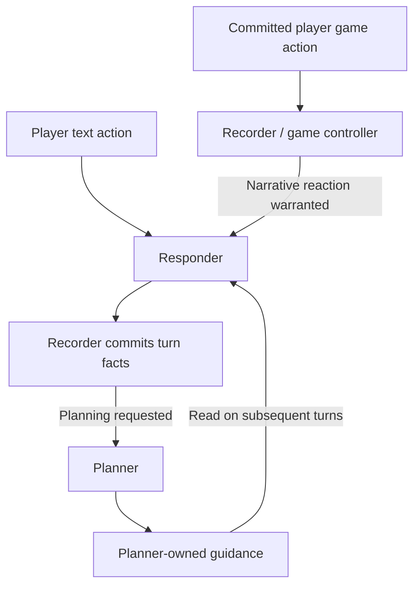

# ADR-001: Separate story recording, planning, and response

- Status: Proposed
- Date: 2026-10-20
- Scope: Adventure Mode story orchestration in `tools/story`

## Context

`StoryTool` currently composes a fast `StoryResponseModule` and a background
`StoryPlanningModule`. The responder resolves immediate player actions and emits
narration, NPC dialogue, dice results, and planning signals. The planner receives
player intentions and completed responses as separate events. It maintains all
durable sticky notes, performs permitted Narratron game actions, and can trigger
a response to a player game action.

This assigns two different kinds of work to the background planner:

- Recording established facts, including inventory, location, resources, and
  committed game developments.
- Developing conditional future events, opposition intentions, setups, and pacing.

Factual recording must finish before another action depends on its results.
Creative planning can take longer and need not run after every action. Combining
them allows the next response to encounter stale factual notes, spends planning
effort on routine bookkeeping, and complicates recovery from partial tool writes.

## Proposed decision

Introduce three roles with distinct write responsibilities. Keep `StoryTool` as
the composition root and orchestrator, with one shared notepad and shared lore
and reference services. All three roles use one ADK session, with a separate
model-visible event projection for each role.

| Role | Responsibility | Authorized mutations |
| --- | --- | --- |
| Recorder / game controller | Reconcile committed events, maintain factual state, choose and execute permitted game responses, and request narration when warranted | Recorder-owned stickies and validated Narratron game actions |
| Responder | Resolve immediate fictional consequences, narrate the scene, speak for NPCs, roll permitted dice, and identify planning needs | Structured response and proposed factual changes; no direct sticky writes |
| Planner | Develop contingent future events, faction intentions, setups, and pacing from committed facts | Planner-owned stickies |

The recorder has two explicit phases: recording established outcomes and
controlling game responses. Selecting a new NPC game action is a new decision,
not a fact inferred to have already happened. The game runtime continues to
validate actions and own mechanical game state.

## Sticky ownership in `planning.yaml`

Each sticky declares exactly one writer using `owner: recorder` or
`owner: planner`. Ownership applies to the whole topic; mixed topics should be
split into factual and planning topics.

```yaml
Inventory:
  owner: recorder
  description: "Items currently possessed."
  initial: "One brass key"

Location:
  owner: recorder
  description: "The player's established location."
  initial: "Outside the archive"

"Archive Investigation":
  owner: planner
  description: "Conditional opposition plans and future developments."
  initial: "The archivist investigates if evidence of entry is discovered."
```

The schema parser must preserve and validate ownership metadata. Role-scoped
schema and update tools must enforce it in application code. Instructions alone
are insufficient. Existing field schemas, rendering, and per-topic validation
remain applicable.

Ownership controls writing, not visibility. Each role receives the readable
context it needs; private planning material must not automatically become
player-visible. Recorder notes establish facts. Planner notes describe intentions
and conditional possibilities and must not be treated as proof that an event
occurred.

## Event flow



### Text actions

1. The orchestrator assigns a stable action ID and ensures preceding causal
   events have been recorded before admitting the action for resolution.
2. The responder reads a consistent snapshot of recorded facts, current game
   state, and available planning guidance. Player input remains an intention
   until resolved.
3. The responder returns narration, dialogue, actual dice results, proposed
   factual changes, and an optional planning request with a reason.
4. The orchestrator always submits the completed response to the recorder.
   Recording does not depend on a planning request.
5. The recorder reconciles the result against established facts, lore, and game
   receipts, commits factual updates, and marks the event recorded.
6. If planning was requested, the orchestrator schedules the planner against the
   newly recorded state. The next player action need not wait for planning.

### Game actions

1. The game runtime validates and commits the player's action. Its action and
   resulting state receipt become input to the recorder.
2. The recorder updates factual projections and, when justified by game rules,
   selects permitted Narratron actions. Each submitted action uses the current
   game revision and produces a new receipt.
3. The recorder can request a responder reaction to significant game developments.
   Routine mechanical changes can finish without narration.
4. Any completed response returns through the mandatory recording path. An
   optional responder planning request is delivered after recording completes.

Recording a response must not automatically replay the game-control phase or
trigger another response. Triggers are associated with specific causal events
and phases so the flow cannot become an unconditional agent loop.

## Shared ADK session and role-specific event visibility

Use one ADK application, session service, and session identity for the adventure.
The identity includes `app_name`, `user_id`, and `session_id`; reusing only the
session ID across independently named applications does not establish a shared
session. Replace the current separate planner and responder session wiring with
an orchestrator that invokes the appropriate role within this shared context.

The session stores the complete persisted event history for debugging and
recovery. Each model request receives a projection of that history, selected by
role, event purpose, and causal position. Storing an event in the session does
not make it visible to every role.

| Context | Recorder | Responder | Planner |
| --- | --- | --- | --- |
| Own prior model outputs and tool exchanges | Yes | Yes | Yes |
| Another role's raw tool exchanges and private intermediate outputs | No | No | No |
| Player text intention | When needed for reconciliation | When resolving the action | When included in a recorded-turn handoff |
| Committed game receipts | When recording or controlling the game | Relevant receipts for narration | Relevant facts in the planning handoff |
| Completed response and proposed factual changes | Explicit recording handoff | Own response history | Recorded outcome supplied after reconciliation |
| Recorded factual state | Yes | Yes | Yes |
| Published planning guidance | When relevant to game decisions | When relevant to response resolution | Own planning state |

Own-event visibility alone is insufficient: the recorder needs the responder's
result, and the planner needs recorded outcomes. Cross-role communication uses
explicit handoff events and published state, without replaying a peer's entire
conversation. A handoff carries its source event IDs, intended recipients,
purpose, and source state revision. The orchestrator supplies this routing
metadata; a model cannot grant visibility to an event by writing instructions
inside its content.

Player inputs, game receipts, recording tasks, and planning requests have distinct
event kinds. Internal messages must never be interpreted as new player actions.
Preserve original author information and causal links when constructing views.
Tool results may use ADK's `user` content role, so filtering by content role or
author alone cannot identify player intent or a complete role history.

### ADK integration approach

The locally installed and locked ADK version is `google-adk==2.9.2`. Its content
builder supports branch-based history filtering, and `before_model_callback`
allows application code to modify the model request. Separate agent names in an
otherwise unfiltered session do not provide the required visibility policy.

Implement an application-owned context builder, applied through supported model
request hooks on every model call, including continuations after tools. Disable
automatic prior-history inclusion with `include_contents="none"`, then explicitly
assemble the role's permitted history, current input, and active tool exchanges.
That setting alone is not a privacy filter: ADK still supplies current-turn
content, which must also satisfy the role's visibility policy. Do not mutate or
remove events from the stored session to obtain a filtered view.

ADK branch filtering can supplement this policy when the workflow establishes
appropriate branches. Its ancestor/unbranched-event visibility does not by itself
express the handoff matrix above. Do not depend on the internal
`isolation_scope` field; the installed ADK explicitly reserves it for internal use.

Additional requirements:

- Preserve complete function-call/result pairs, IDs, and ordering in each model
  request. Do not splice tool results from another role into a live tool exchange.
- Give each role distinct output state keys and scoped mutation tools. Shared
  session state is not automatically isolated by event-history filtering; state
  interpolation, tools, and context builders must obey the same visibility rules.
- Compact or summarize each permitted view independently, retaining source event
  positions and audience. Disable session-wide automatic history compaction until
  it can preserve this policy; a mixed summary can expose private peer content.
- Coordinate session appends and shared-state commits through the orchestrator.
  A shared session does not itself make concurrent independent runner writes safe
  or make multi-event factual updates atomic. Background planning must retain the
  earlier snapshot and publication checks.
- Keep player-facing delivery separate from session persistence. Recorder and
  planner confirmations and internal handoffs remain internal even though the
  session contains them.

This consolidates storage and tracing while preserving distinct contexts. It does
not imply a shared model conversation, shared provider cache, or reduced token
cost without measurement.

## Consistency and failure handling

- Use stable action and event IDs, causal links, and durable recording progress.
  Distinguish a player intention, its resolved response, and individual committed
  game actions while preserving their relationship.
- Record proposed factual changes as structured data alongside prose. The
  recorder must reconcile them rather than blindly accept them. Narrative claims
  cannot override the game runtime's validated state.
- Stage related factual note changes and publish them together with recording
  progress. A subsequent action must not read a partially recorded turn.
- Preserve committed game receipts across retries. Note recording and game
  actions are separate commit boundaries; retrying projection or narration must
  not execute an already committed game action again.
- Capture the state revision with the actual response snapshot. A revision read
  earlier than the snapshot is insufficient to identify what the responder saw.
- If recording fails, retain the pending event and retry safely. Dependent player
  actions remain queued until recording finishes. Already delivered narration is
  not a license to skip recording or duplicate its effects.
- Planner work carries its source event position and relevant state dependencies.
  Recheck affected guidance before publication if newer facts invalidate it.
  Planner failure may delay guidance but must not block factual recording.
- Planner output cannot retcon established events. Once a planned development
  actually occurs through response resolution or a game action, the recorder
  records it as a fact.

## Scheduling and efficiency

The recorder processes every committed event that affects factual state. Prefer
ordinary code for direct projections of validated game state. Keep any recorder
model context and reasoning budget focused on reconciliation and required game
decisions.

The planner runs when the responder requests it, rather than automatically on
both player intention and completed response. Explicit initialization or
orchestrator requests can establish or refresh guidance when no narrated turn
exists. Planning requests may be coalesced, retaining their reasons and source
events.

This adds a recording completion boundary between dependent actions. It may
increase latency or total cost when an LLM recorder is required. It is a proposed
tradeoff, not a demonstrated performance improvement. Measure first narration
latency, readiness for the next action, cost per action, planning lag, and factual
continuity errors separately.

## Implementation direction

1. Add validated sticky ownership and role-scoped notepad tools. Migrate existing
   adventure schemas explicitly; do not silently guess ownership of legacy notes.
2. Extract factual recording, game actions, and game-triggered response handling
   into a recorder module. Retain creative planning in the planning module.
3. Extend structured response output with proposed factual changes and a planning
   request. Keep the existing planning-request tool as an optional way to populate
   that request; scheduling remains the orchestrator's responsibility.
4. Consolidate ADK wiring into one application/session and add the role-specific
   context builder, explicit handoffs, scoped output keys, and compatible history
   summarization. Preserve the full stored event history.
5. Add durable event identity, recording progress, staged note publication, and
   retry handling before enabling the new scheduling behavior.
6. Wire the mandatory response-to-recorder path and selective planner scheduling
   through `StoryTool`. Route canonical character and scene mutations through
   explicit ownership contracts so they do not bypass factual recording.
7. Update the test harness to exercise production scheduling as well as a fully
   drained deterministic mode.

Validation should cover unauthorized sticky writes, rapid dependent actions,
recording without planning, planning after recording, partial failures and retries,
game-action deduplication, stale guidance, and prevention of trigger loops. Capture
actual model requests to verify own-role history, authorized handoffs, exclusion
of peer internals, correct tool pairing, summary isolation, and distinct output
keys across interleaved runs and restarts.

## Alternatives considered

- **Keep the current split:** Fewer roles, but factual recording and creative
  planning continue to share scheduling and failure behavior.
- **Let the responder write factual notes directly:** Avoids a separate model
  pass, but adds reconciliation and game-control responsibilities to the fast
  responder. Useful as a performance baseline.
- **Run all three roles serially on every action:** Simple ordering, but makes
  optional creative planning part of every action's critical path.
- **Separate ADK sessions for each role:** Provides simpler history separation,
  but requires explicit synchronization and separate traces. Retain as a fallback
  if shared-session projections cannot reliably preserve visibility and recovery.

This ADR records a proposal only. It does not change runtime behavior or claim
that adding a third role will improve performance without measurement.
